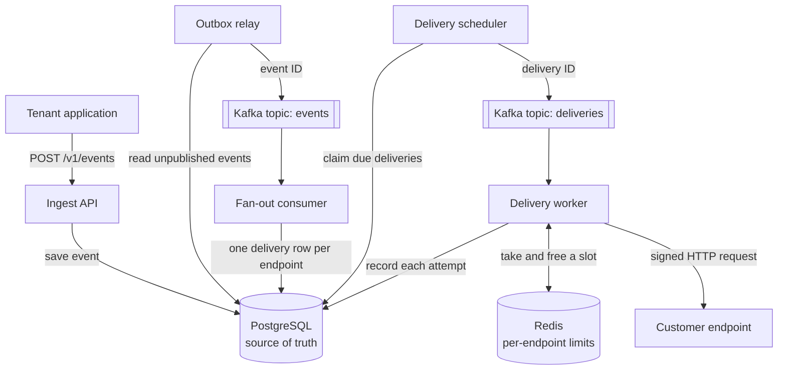

# Hookflow

Hookflow is a multi-tenant webhook delivery service. An application sends it an event once, and Hookflow delivers that event to every endpoint the application has registered, with signing, retries and a full delivery log.

What makes it different is **adaptive flow control**. Every endpoint has its own concurrency limit, and the limit moves by itself: each success raises it a little, each failure halves it. This is the rule TCP uses for congestion control (AIMD), applied to webhook receivers. A struggling endpoint is eased off automatically, and it cannot slow down deliveries to anyone else.

Built with Java 25, Spring Boot 4, PostgreSQL, Kafka and Redis.

## The problem

A webhook sender calls servers it does not control. They can be slow, down or overloaded. The usual designs each have a weakness:

- **One shared worker pool.** A single slow receiver ties up the workers, so every other customer's deliveries are delayed.
- **A fixed limit per endpoint.** This isolates customers, but the number is a guess. Set too high, it overloads a struggling receiver. Set too low, it holds back a fast one. Someone has to tune it.

Hookflow removes the guess. Nobody configures a rate; each endpoint's limit finds its own level.

## How it works



1. A tenant calls `POST /v1/events`. The API saves the event in Postgres and answers `202 Accepted`.
2. The **outbox relay** publishes the IDs of saved events to Kafka.
3. The **fan-out consumer** creates one delivery row per endpoint of that tenant.
4. The **delivery scheduler** publishes the ID of every delivery that is due.
5. A **delivery worker** asks the flow controller in Redis for a slot on the endpoint. With a slot it signs and sends the request; without one the delivery waits in Redis until a slot frees up.
6. The worker records the attempt and reports the outcome, which moves the endpoint's limit.
7. A failed delivery becomes due again later, with growing waits. After the last attempt it is marked `DEAD` and can be replayed through the API.

Three decisions shape the design:

- **Postgres is the source of truth.** Kafka and Redis only move work around. Nothing reaches Kafka unless it is in Postgres first, so losing Kafka or Redis data delays deliveries but never loses them.
- **One rule decides what runs next.** A delivery is due when its `next_attempt_at` has passed. That covers new deliveries, retries, and work abandoned by a crashed worker, because handing a delivery on always pushes that time forward as a lease.
- **A Kafka partition is never blocked by a slow endpoint.** A delivery with no free slot is parked in Redis and the worker moves on.

## Adaptive flow control

| Signal from an attempt | Effect on the endpoint's limit |
| --- | --- |
| The endpoint answered (anything except `5xx`, `429`, `408`) | Add `1 / limit`: about +1 for every full round of successes |
| Timeout, connection error, `5xx`, `429` or `408` | Halve the limit, at most once per second |
| Failure while already at the minimum limit | Pause the endpoint; the pause doubles each time, up to 60 seconds |

The limit and the slots live in Redis so that every application instance shares them. Two Lua scripts ([acquire.lua](src/main/resources/lua/acquire.lua) and [release.lua](src/main/resources/lua/release.lua)) do the work, because Redis runs a script as one uninterrupted step: two workers can never both take the last slot.

Slots are stored with an expiry time, not as a counter. If a worker crashes while holding a slot, the slot frees itself when its lease runs out.

`hookflow.flow-control.mode` also accepts `fixed` (a constant limit) and `none` (no per-endpoint limit). They exist as baselines to compare against.

## What happens when something fails

| Failure | What happens | Result |
| --- | --- | --- |
| The app crashes after saving an event | The outbox relay publishes it after restart | Delayed, not lost |
| Fan-out handles the same event twice | A unique constraint makes the second run create nothing | No duplicates |
| A worker crashes during an HTTP call | The delivery's lease runs out and the scheduler queues it again | Possible duplicate send |
| Redis loses its data | Limits restart at the initial value; waiting deliveries are queued again when their leases run out | Delayed, not lost |
| Kafka is unavailable | Publishing fails, rows stay due in Postgres, and the two jobs keep trying | Delayed, not lost |
| Postgres is unavailable | The API answers `503` | Nothing is accepted that cannot be stored |

Delivery is **at least once**. An HTTP request can succeed while its response is lost, so a sender can never be sure and must resend. Every retry carries the same `webhook-id`, which receivers use to ignore duplicates.

## Run it

You need Docker. This starts Hookflow, its databases, a mock receiver and monitoring:

```bash
docker compose --profile app --profile loadtest --profile monitoring up -d --build
```

| Service | Address |
| --- | --- |
| Hookflow API | http://localhost:8080 |
| Mock receiver (pretends to be customers' endpoints) | http://localhost:9000 |
| Grafana, with a ready-made dashboard | http://localhost:3000 |
| Prometheus | http://localhost:9090 |

Then send an event through (in Git Bash, or any Unix shell):

```bash
# 1. Create a tenant. The API key is shown only once.
curl -s -X POST localhost:8080/v1/tenants \
  -H "X-Admin-Token: dev-admin-token" -H "Content-Type: application/json" \
  -d '{"name": "Acme"}'

export KEY=hf_...   # the apiKey from the response

# 2. Register an endpoint. The signing secret is shown only once.
curl -s -X POST localhost:8080/v1/endpoints \
  -H "Authorization: Bearer $KEY" -H "Content-Type: application/json" \
  -d '{"url": "http://mock-receiver:9000/hook/1"}'

# 3. Send an event.
curl -s -X POST localhost:8080/v1/events \
  -H "Authorization: Bearer $KEY" -H "Content-Type: application/json" \
  -H "Idempotency-Key: order-1042-paid" \
  -d '{"type": "order.paid", "payload": {"orderId": 1042, "amount": 4999}}'

# 4. See the event and its delivery, then what the receiver got.
curl -s localhost:8080/v1/events/<event id> -H "Authorization: Bearer $KEY"
curl -s localhost:9000/admin/stats
```

### Run it from your IDE instead

Start only the databases with `docker compose up -d`, then run the app with the `local` profile:

```bash
./mvnw spring-boot:run -Dspring-boot.run.profiles=local
java mock-receiver/MockReceiver.java        # in a second terminal
```

In this setup endpoints use `http://localhost:9000/hook/1`. The build needs JDK 25.

## Watch flow control react

Start a steady load, then break one endpoint and watch its limit:

```bash
# 400 events per second, spread over 20 endpoints, for one minute.
docker run --rm -i --network hookflow_default \
  -e BASE_URL=http://app:8080 -e RECEIVER_URL=http://mock-receiver:9000 \
  -e RATE=400 -e DURATION=60s grafana/k6 run - < loadtest/steady-load.js

# While it runs: make endpoint 1 fail, and later restore it.
curl -X POST "localhost:9000/admin/behavior?path=/hook/1&status=503"
curl -X POST "localhost:9000/admin/behavior?path=/hook/1&status=200"
```

The load test prints a `curl` command that shows endpoint 1's live limit, and the Grafana dashboard graphs every endpoint's limit over time. You should see endpoint 1's limit collapse to 1 and its deliveries queue up, while the other endpoints carry on. After you restore it, the queue drains within seconds.

## API

Every call except creating a tenant needs `Authorization: Bearer <api key>`. Errors use the RFC 9457 problem-details JSON format.

| Method and path | Purpose |
| --- | --- |
| `POST /v1/tenants` | Create a tenant and get its API key. Needs the `X-Admin-Token` header. |
| `POST /v1/endpoints` | Register a URL and get its signing secret |
| `GET /v1/endpoints` | List the tenant's endpoints |
| `PATCH /v1/endpoints/{id}` | Change the URL, or enable and disable |
| `GET /v1/endpoints/{id}/flow` | Live flow-control state: limit, in flight, waiting, paused |
| `POST /v1/events` | Send an event. An optional `Idempotency-Key` header makes retries safe. |
| `GET /v1/events/{id}` | An event with its deliveries |
| `GET /v1/deliveries` | List deliveries. Filters: `endpointId`, `status`, `page`, `size`. |
| `GET /v1/deliveries/{id}` | A delivery with every attempt made |
| `POST /v1/deliveries/{id}/replay` | Queue a `DEAD` delivery again |

### What receivers get

Requests follow the [Standard Webhooks](https://github.com/standard-webhooks/standard-webhooks/blob/main/spec/standard-webhooks.md) specification, so receivers can verify them with existing libraries.

```http
POST /hook/1
Content-Type: application/json
webhook-id: a7588b34-49aa-444f-bc90-2ca61f533d4d
webhook-timestamp: 1791816842
webhook-signature: v1,K5oZfzN95Z9UVu1EsfQmfVNQhnkZ2pj9o9NDN/H/pI4=

{"type":"order.paid","timestamp":"2026-10-12T14:54:02.153293Z","data":{"orderId":1042,"amount":4999}}
```

The signature is the base64 HMAC-SHA256 of `id.timestamp.body`, keyed with the endpoint's secret.

## Configuration

Settings live in [application.yaml](src/main/resources/application.yaml) under `hookflow`. The ones you are most likely to change:

| Setting | Default | Meaning |
| --- | --- | --- |
| `admin-token` | none, required | Protects `POST /v1/tenants`. Set `HOOKFLOW_ADMIN_TOKEN`. |
| `allow-insecure-urls` | `false` | When false, endpoint URLs must use https and must not point at private addresses |
| `delivery.request-timeout` | `10s` | How long to wait for a receiver |
| `delivery.retry-delays` | `5s, 30s, 2m, 10m, 30m, 1h, 2h` | Wait before each retry, so 8 attempts in total |
| `delivery.max-in-flight` | `500` | Most deliveries one instance handles at once |
| `flow-control.mode` | `adaptive` | `adaptive`, `fixed` or `none` |
| `flow-control.initial-limit` | `4` | Limit for an endpoint with no history |
| `flow-control.max-limit` | `200` | The limit never grows past this |
| `flow-control.max-pause` | `60s` | Longest pause for an endpoint that keeps failing |

## Tests

```bash
./mvnw verify
```

The 65 tests need Docker, because the integration tests run against real Postgres, Redis and Kafka through Testcontainers.

| Test | What it covers |
| --- | --- |
| `WebhookSignerTest` | Signatures match the published Standard Webhooks example |
| `RetryPolicyTest`, `AttemptOutcomeTest` | Retry waits, jitter, and how each status code is classified |
| `UrlValidatorTest`, `ApiKeyGeneratorTest` | Private-address blocking and key generation |
| `RedisFlowControllerTest` | The real Lua scripts on a real Redis: no over-granting under contention, lease expiry, limit growth and halving, pausing, hand-off |
| `TenantAndEndpointApiTest` | Authentication, validation and tenant isolation |
| `EventDeliveryTest` | The whole path: signed delivery, idempotency, retries, dead-lettering, replay |

## Measured results

These are single runs of 30 to 50 seconds on one 16-thread laptop, with Hookflow, its databases, the mock receiver and the load generator all sharing that machine in Docker. Treat them as a first indication, not a benchmark.

| Events per second | Accepting an event (average) | Delivery time, median | Delivery time, 99th percentile |
| --- | --- | --- | --- |
| 500 | 15 ms | about 240 ms | 400 to 470 ms |
| 1,000 | 109 ms | 500 to 580 ms | 950 to 1,070 ms |

Delivery time runs from the API accepting an event to the receiver getting it. About 200 ms of it is the two polling jobs, which run every 100 ms.

**One endpoint failing.** At 400 events per second over 20 endpoints, one endpoint returned `503` for 18 seconds:

- Its limit had climbed from 4 to 21. It fell to 1 and the endpoint was paused.
- 708 deliveries queued for it. They drained in under 4 seconds once it recovered and its pause ended.
- The other 19 endpoints kept a median delivery time of about 205 ms and a 99th percentile of about 300 ms throughout.
- All 19,998 events were delivered, with no duplicates.

**Failures.** Two of the cases in the failure table were checked by hand:

- *App killed mid-load.* At 200 events per second the app container was killed and restarted. 2,365 events had been stored by then. All 2,365 were delivered within 40 seconds of the restart, with no duplicates; the 53 that were mid-flight were picked up again when their leases ran out.
- *Postgres stopped.* The API answered `503` within 3 seconds, and accepted events again as soon as Postgres was back.

A JVM that has just started is much slower for its first 20 to 30 seconds, so warm it up with a short run before measuring.

## Project layout

```
src/main/java/com/hookflow/
  auth/         API-key and admin-token authentication filter
  tenant/       tenants and API keys
  endpoint/     endpoints, URL validation, signing secrets
  event/        accepting events, outbox relay
  fanout/       one event into one delivery per endpoint
  delivery/     dispatcher, worker, signing, HTTP sending, delivery API
  retry/        retry policy and the delivery scheduler
  flowcontrol/  the FlowController interface and its Redis implementation
  config/       typed settings and Kafka topics
  common/       error handling
src/main/resources/
  db/migration/ Flyway SQL migrations
  lua/          the two flow-control scripts
mock-receiver/  a stand-in for customers' endpoints (single Java file)
loadtest/       k6 load script
ops/            Prometheus and Grafana configuration
```

## Trade-offs

- **Kafka for transport, Postgres for state.** A database table could serve as the queue at this scale and would be simpler. Kafka earns its place by absorbing bursts and spreading work across instances through consumer groups.
- **Polling jobs publish to Kafka.** This adds about 100 ms per hop, in exchange for a simple guarantee: work exists in Postgres before it exists anywhere else.
- **Deliveries are keyed by endpoint.** One endpoint's work stays on one partition, at the cost of a very busy endpoint making one partition busier than the rest.
- **Redis holds flow-control state.** In-memory counters would be faster, but with several instances each one would allow the full limit.

## Limitations

- The three flow-control modes have not been compared side by side yet.
- Only two failure cases have been tried, by hand (see Measured results). Losing Redis or a Kafka broker under load is untested, and none of it is scripted.
- The limit reacts to errors and timeouts only. A slow endpoint that still answers within the timeout is bounded by its limit but not actively slowed down.
- A `429` response's `Retry-After` header is ignored.
- Deliveries waiting on an endpoint that never recovers are kept indefinitely. They need an age limit.
- Signing secrets are stored unencrypted, because Hookflow needs the real secret to sign requests.
- URL safety is checked when an endpoint is registered, not again at send time, so a hostname that later resolves to a private address is not caught.
- The `delivery_attempts` table grows without limit. It needs a retention job or partitioning.
- Metrics are tagged per endpoint. That suits hundreds of endpoints, not millions.
- Ordering is not guaranteed: a retried event can arrive after a newer one.
- Kafka topics are created with a replication factor of 1, for a single local broker.
